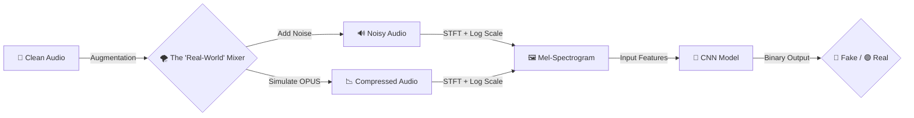

# 🛡️ Deep-Voice Defender (WhatsApp-Ready)


> **"Deepfakes don't spread in studios. They spread on WhatsApp."**

**Deep-Voice Defender** is a robust Deep Learning system designed to detect AI-generated speech in **real-world scenarios**. Unlike standard academic models that fail on compressed audio, our architecture is specifically trained to handle the **OPUS codec compression** and **environmental noise** found in messaging apps like WhatsApp, Telegram, and Signal.

---

## 🎯 Our USP: "The Real-World Layer"

Most detectors achieve 99% accuracy on clean data but drop to 50% when a file is sent via WhatsApp. We solve this by introducing a **Dynamic Corruption Layer** during training:

1.  **OPUS Simulation:** We train on audio crushed to 16-32kbps bitrates to mimic messaging app compression.
2.  **Noise Injection:** We introduce Gaussian noise and environmental background sounds (traffic, fans) to force the model to learn invariant features.

---

## 🧠 How It Works (The Robust Pipeline)



---

## 📊 Dataset & Augmentation

We rely on the **ASVspoof 2019 (Logical Access)** dataset, hardened with our custom augmentation pipeline.

| Feature | Standard Models | **Deep-Voice Defender** |
| :--- | :---: | :---: |
| **Data Source** | Clean FLAC files | Compressed & Noisy Audio |
| **Bitrate** | Lossless (High Quality) | Variable (Low to High) |
| **Robustness** | ❌ Fails on WhatsApp | ✅ Works on WhatsApp |
| **Noise Handling** | ❌ Sensitive to Silence | ✅ Robust to Background Noise |

---

## 🛠️ Installation & Setup

<details>
<summary><b>Click to expand Installation Steps</b></summary>

### 1. Clone the Repository
```bash
git clone [https://github.com/YOUR_USERNAME/deep-voice-defender.git](https://github.com/YOUR_USERNAME/deep-voice-defender.git)
cd deep-voice-defender
```

### 2. Create the Virtual Environment
```bash
# Linux / WSL
python3 -m venv venv
source venv/bin/activate
```

### 3. Install Dependencies
```bash
pip install -r requirements.txt
```

### 4. Setup Data
Download the **ASVspoof 2019 LA** dataset and place it in `data/raw/LA/`.
</details>

---

## 🚀 Usage

### 1. Preprocessing
Standardizes the dataset length and sample rate.
```bash
python src/preprocessing.py
```

### 2. Training (With Augmentation)
Trains the CNN with the custom "WhatsApp-Simulation" layer active.
*(Coming Soon)*
```bash
python src/model.py
```

---

## 🗺️ Roadmap & Progress

**Current: conference-paper upgrade (v2) — an empirical codec-robustness study on ASVspoof 2019 LA.**

- [x] **v2 pipeline:** preprocessing (global-stat mels), static augmentation pool
      (true-Opus / resample / noise), resumable trainer, official EER + min t-DCF eval.
- [x] **All 15 training runs** (5 augmentation modes × 3 seeds) trained on Kaggle GPUs
      (2026-10-24; best dev EER 2.5–4.0 % for the full-augmentation mode).
- [ ] **Clean eval sweep** on dev+eval for all 15 models (next step — see
      [`docs/SUPERVISOR_RUNBOOK.md`](docs/SUPERVISOR_RUNBOOK.md) for the exact procedure).
- [ ] **Codec-robustness matrix** (re-encoded eval set) + **ASVspoof 2021 LA** cross-corpus eval.
- [ ] **Figures, efficiency table, paper** (`paper/PLAN.md`).

Supervising the training/eval pipeline? Start with
[`docs/SUPERVISOR_RUNBOOK.md`](docs/SUPERVISOR_RUNBOOK.md) — it has every command,
guardrail and failure playbook. Project state lives in [`WORKLOG.md`](WORKLOG.md).

---

## 👨‍💻 The Team

| Name | Role | GitHub |
| :--- | :--- | :--- |
| **Harshil** | Lead Developer / AI Engineer | [@Harshil](https://github.com/harshil-sri) |
| **Mrigank** | Developer / Data Engineer | [@Mrigank](https://github.com/mrigank-rana) |

---

<div align="center">
  <sub>Built with 💀 and ☕ by the Deep-Voice Defender Team.</sub>
</div>